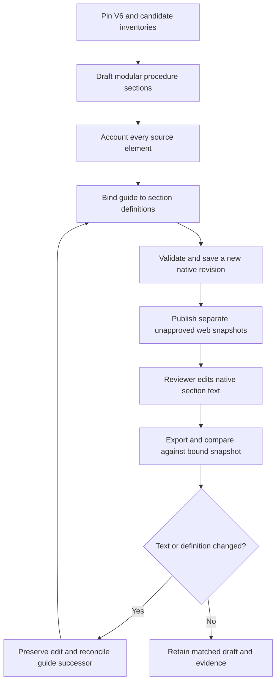

# Editorial proposal and guide alignment workflow — version 1.3.0

Effective for the unapproved historical pilot, 21 October 2026. Additive companion
to the published workflow release 1.11; that release is preserved. This records
SP-07a's new manual path; it does not replace clinical review/approval/issuance.

Owner: Workbench integration for proposal tooling and additive native artefacts;
policy/template authorities retain substantive decisions. Inputs: pinned source,
candidate and prior guide. Outputs: versioned sections, complete disposition ledger,
bound guide, separate web snapshots and recovery package. Check exact target/schema,
inherited access and current-account writes before delivery. No new licence,
permissions or connector are required by this manual fallback.

On changed native text or mismatched identity/hash, stop that revision's publication,
retain the edit and reconcile. A retry with unchanged content must create zero rows.
Do not regenerate over human Word edits. Current-source verification stays separate
and nonblocking for development. See [pilot details](discharge-simplification.md)
for limits, evidence and recovery. No automatic polling, notifications, approvals
or source-register mutation occurs in this path.

Version 1.1 adds verified browser-form editing and an explicit operator CLI successor step. Use the command in [pilot details](discharge-simplification.md). Preserve the earlier guide, review every guide section, record rationale and choose new procedure/guide revisions. Validation refuses stale bindings, changed scope/definitions and existing output paths. Qualification used fictional content under the current site-administrator account; ordinary-user runtime remains SP-07d. No automatic cloud edit trigger is claimed.

Version 1.2 supersedes routine CLI execution with the cloud/web Capture → review context → Reconcile → separate guide-revision path. Exact source snapshot comparison runs in Power Automate; stale source or conflicting revision holds without overwrite. Refer to [the web operator workflow](web-guide-reconciliation.md). Historical 1.0/1.1 qualification remains recorded above.

Version 1.3 adds the [review-experience walkthrough](review-experience-walkthrough.md): finding → editorial proposal → companion guide → Draft change/impact record → recorded history and exact snapshot reconciliation → pending human wording/usability decision. This reuses the existing web flow and records; no policy approval or new automatic clinical review is introduced.
