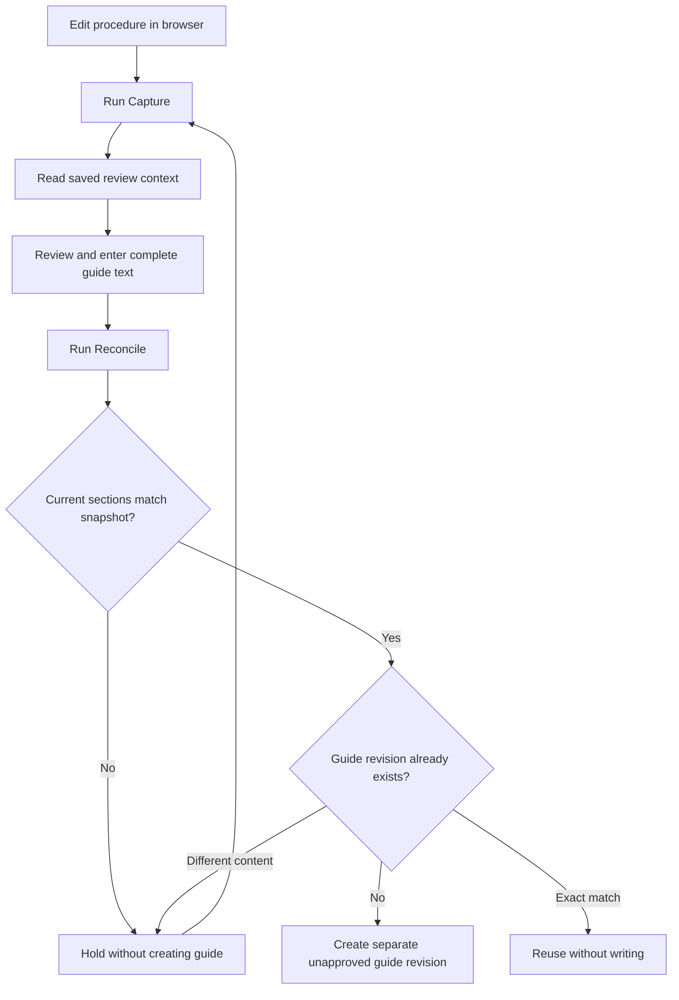

# Web guide reconciliation — 1.0.0

The operator path now runs in the browser: native procedure editing, Power Automate
run form, review snapshots and reconciled guide revisions. Local scripts are used
for implementation/recovery, not for routine reconciliation. The earlier CLI
reconciler remains an optional recovery tool.

## Use

1. Edit the appropriate procedure section in **PPG Review Section Proposals** and
   save. Its version history retains the earlier text. Keep source identity and
   definition fields intact; clinical or structural changes still need review.
2. Open **PPG | Web guide reconciliation** in Power Automate and choose **Run**.
   Select **Capture**, enter any section item ID from the procedure revision, and
   a new review snapshot name. Leave Reconcile inputs blank. The flow captures
   every section with that DocumentUID and ProposalRevision, not just the anchor.
3. Open the new item in **PPG Guide Review Contexts**. Read its SourceReviewText
   alongside the existing guide and source evidence. Note its numeric item ID.
4. Prepare the complete revised guide text, preserving all relevant sections and
   explicitly resolving the editorial implications. Run the same flow with
   **Reconcile**, entering the context item ID, a new guide revision, the complete
   guide text and the reason/reconciliation notes. Leave Capture inputs blank.
5. Open **PPG Reconciled Guide Revisions** and check the saved multiline guide,
   rationale, context ID and procedure revision. This is an unapproved draft.
   Earlier pages/guide records are not overwritten or automatically republished.

If any captured procedure section/version differs at reconciliation time, the run
fails visibly with **ReconciliationHeld** and creates no guide. Capture a fresh
snapshot, review the changes and reconcile again. A retry with the same context
and revision reuses an exactly matching output. A conflicting revision is held;
choose a new revision instead of overwriting human work. Duplicate keys are also
rejected natively. Capture names and guide revisions are limited to 100 characters.

A context binds the full procedure snapshot observed by the cloud run; it is not
continuous synchronisation, a transaction locking editors, or proof that the
wording is clinically correct. Later source edits require a new capture/review.
Keep earlier context/guide records intact; their native histories preserve edits.
The flow never updates a procedure, source register, issued document or old guide.

## Workflow

## Capabilities and boundaries

Only the existing **standard SharePoint connector** and built-in Power Automate
actions are used. The SharePoint HTTP action is part of that connector, not the
premium generic HTTP connector. See [Microsoft's connector reference](https://learn.microsoft.com/en-us/connectors/sharepointonline/).
The exact existing connection, target List writes, native save and runtime were
verified. No new consent, licence assignment, spending, AI entitlement or Word
runtime is required by this path. SharePoint structured document generation remains
the preferred later production route; this bounded guide-record workflow is the
supported web fallback while generation parity remains unqualified.

The flow is on demand, single-run concurrency, create-only output, with connector
write retries disabled. It has no schedule, owner notifications or clinical
approval action. Per-flow failure-alert delivery is off; inspect native run history
for a held/error outcome. Partial inventories and oversized snapshots fail closed
instead of presenting incomplete coverage. Run history is supplementary evidence;
the versioned Lists retain source snapshots and guide content.

Current owner-account operation is qualified. Ordinary-user/runtime testing remains
open and nonblocking; inherited access does not grant flow run-only permission to
others. No access changes were made. Historical V6/template-candidate authority
remains unverified and nonblocking for development; no clinical adoption is implied.

## Version and recovery

Generic builder: `tools/guide-reconciliation/build.py`; List contract:
`config/guide-web-reconciliation.json`. Bind the existing permitted site, section
List, new context/guide Lists and qualified SharePoint connection privately. Create
stopped, verify definition/targets, disable failure-alert delivery, then enable only
the on-demand trigger. Never replace another owner's flow or alter connection access.

Private native receipts and recovery are under the integration-owned
`web-reconciliation-v1` evidence folder. Rebuild using private bindings, verify the
sanitised builder reproduces the definition, and restore into separate revisions.
Existing Lists/pages/source files and issued history remain preserved. SharePoint
Lists are external to Dataverse solution packaging; reconcile their identities and
the new flow with the shared ALM inventory owner using the private receipts.
